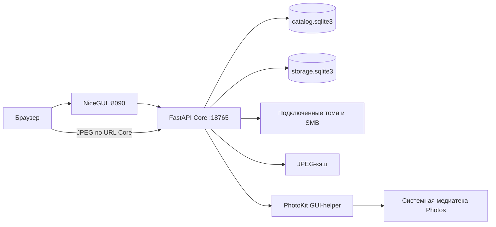

# Архитектура

Статус: текущая реализация `0.1.0-dev`, сверено 2026-11-03.

## Границы системы

media.actu — локальное приложение с отдельными процессами FastAPI Core и NiceGUI UI.
Рабочая схема размещает оба процесса, SQLite, подключённые носители и PhotoKit на M4;
браузер ноутбука подключается через SSH-туннель. Развёрнутый M4 не опрашивался в рамках
этой документальной сверки. Адреса и команды см. в [развёртывании](deployment.md).

Core единолично работает с пользовательской файловой системой и базами. UI получает
данные через HTTP, хранит состояние представления и не открывает SQLite или оригиналы.
Импорты небольших функций валидации пути и общих констант Core-модулей в UI не означают
вызова файловых операций. Код HTTP-клиента: [`core_request`](reference/ui.md#symbol-core_request).

Браузер получает URL JPEG на основе `core_url`; поэтому принятой схеме туннеля нужны
оба порта: UI и Core. Политика адресов Core и UI должна согласовываться при изменении запуска.

## Точки входа и композиция

[`lifespan`](reference/app.md#symbol-lifespan) — жизненный цикл Core. Экземпляры служб создаются на уровне
модуля `app.py`, до входа в lifespan; сам импорт поэтому создаёт каталоги данных,
инициализирует таблицы и выполняет локальные миграции. `--lifespan off` отключает
запуск фоновых служб, но не эти действия импорта. Для проверок обязателен отдельный
`MEDIA_ACTU_DATA_DIR`.

[`register_workspace_page`](reference/workspace_ui.md#symbol-register_workspace_page) регистрирует `/`.
Для каждого клиента создаётся `StorageWorkspace` с двумя `BrowserPane`.
[`main`](reference/media_manager--service_runtime.md#symbol-main) — обёртка запуска для журналов Launcher.
Полная карта файлов — [справочник модулей](reference/README.md).

## Подсистемы и владение

| Подсистема | Службы | Постоянные данные | Работа |
| --- | --- | --- | --- |
| Медиаиндекс | Catalog, scan_sources, SourceWatcher | catalog.sqlite3 | Обычные источники прежней модели и объекты Photos |
| Тома и NAS | StorageCatalog, NetworkCatalog | storage.sqlite3 | Монтирования, ID, ресурсы, снимки папок |
| Учёт копий | CopyCatalog | storage.sqlite3 | Основные папки, номера, источники, отключения |
| Служебные описания | FolderMarkerService | storage.sqlite3 + JSON папок | Постоянная очередь маркеров и повторные попытки |
| Изменения папок | FolderTrackingService | настройки и changed_at в storage | Watchdog-сигнал изменения основной папки |
| Размеры | DirectorySizeService | directory_sizes | Логический объём, полнота, актуальность |
| Поиск имён | ComparisonCatalog | comparison_* | Одна исходная область, до 16 целей и старые отчёты |
| Парные сверки | PairedComparisonCatalog | paired_* | Структура, путь/размер, дополнительный SHA-256 |
| Копирование | MissingCopyCatalog | copy_operations/items | План и создание отсутствующего без перезаписи |
| Медиатеки | PhotoLibraries, PhotosBrowser | catalog.sqlite3 | Сопоставление профилей, виртуальные годы и месяцы |
| Оригиналы | PhotosOriginals | catalog.sqlite3 + папки копий | Манифест, квитанции и потоковая запись новых файлов |
| Расписание | PhotosSyncSchedule | catalog.sqlite3 | Окна работы и постоянные запросы оригиналов |
| Превью индекса | ThumbnailService, ThumbnailWorkerPool | каталог + JPEG-кэш | Постоянная очередь, отдельные виды воркеров |
| Превью томов | StoragePreviewService | JPEG-кэш | Фото/видео по запросу, вне медиаиндекса |

Полные определения таблиц, индексы, ограничения и внешние ключи: [модель данных](data-model.md).

## Запуск и остановка

Lifespan запускает SourceWatcher, отслеживание основных папок и службу маркеров,
снимает оставшиеся состояния сканирования, проверяет подключение Photos.
Обычные доступные `sources` подписываются на Watchdog и сканируются; активная Photos
сканируется при отсутствии первичного индекса или last_scan_at. Затем запускаются
расписание и воркеры превью, а для macOS — проверка подключения Photos каждые 30 секунд.

При закрытии отменяется монитор Photos, останавливаются наблюдатели, размеры,
расписание, оригиналы, копирование и сверки, очередь превью и адаптер; пул сканирования
получает `shutdown(wait=False, cancel_futures=True)`. Различные `join(timeout=...)`
ограничивают ожидание, но не гарантируют мгновенного завершения системного чтения
недоступного SMB. Состояние после аварии восстанавливают конструкторы и методы reset.

## Потоки и асинхронность

HTTP-обработчики — преимущественно `async def`; синхронную файловую работу они
передают `asyncio.to_thread`. Это освобождает event loop, но не превращает системный
вызов в отменяемую транзакцию. Сканирование использует отдельный ThreadPoolExecutor
из двух потоков и блокировку по source_id. Сверки, копирование, расписание и оригиналы
имеют собственные потоки и кооперативные Event-флаги остановки.

Обычные превью обрабатывают два воркера, Photos — один. Подсчёт размеров создаёт два
потока при первом запросе. Файловые превью вне индекса ограничены Semaphore(2).
`comparison_gate` и внутренние блокировки согласуют конфликтующие операции,
но не являются общей транзакцией всех служб. Подробно: [выполнение и потоки](development/runtime.md).

## Три модели просмотра

1. **Обычный том**: загружается один уровень папки; успешный список сохраняется.
   При отключении доступен снимок с `cached=true`, а не доказательство текущего состояния.
2. **Photos**: `photos-<source_id>` — виртуальный ID UI; дерево годов/месяцев читается
   из SQLite. Числовой лист обозначает media_id, не путь оригинала. Такой ID нельзя
   подставлять в операции обычных файловых томов.
3. **Отчёт сверки**: дерево строится по сохранённому индексу отчёта; его раскрытие
   не означает живое чтение того же пути на диске.

Это разные источники данных одного интерфейса. [`StorageWorkspace.read_directory`](reference/workspace_ui.md#symbol-StorageWorkspace.read_directory)
маршрутизирует обычные и виртуальные списки; `ComparisonTree` работает с отчётами.
Медиаиндекс `Catalog.folder_tree` всё ещё собирает своё дерево целиком, обычные панели
грузят уровни, Photos использует страницы, связанное Vue-дерево виртуализирует DOM.
Единого общего утверждения «деревья целиком» или «всё ленивое» для приложения нет.

## Проверка и запись

Парная структура сопоставляется по точному относительному пути; общая сверка имён
использует NFC/casefold и отдельную семантику непосредственного родителя.
Совпадение имени/размера, SHA-256 и квитанция Photos различаются по гарантиям.
Ошибка чтения означает unverified, а не подтверждённое отсутствие.

Обычные копии получают данные из основной или другой копии своего набора.
У Photos источник — системная медиатека либо другая привязанная копия этой же медиатеки.
Хранящиеся рёбра направлены от назначения к источнику; циклы проверяются при изменении.
«Сделать первой» у Photos перенумеровывает копии; маршруты меняются отдельной командой.

Сверка не изменяет пользовательские файлы. `MissingCopyCatalog` фиксирует план, UI
показывает его, отдельный start выполняет создание отсутствующего. `PhotosOriginals`
пишет поток в новую конечную цель через буфер 64 МиБ. Существующие пути не заменяются.
Служебные маркеры — отдельное разрешённое изменение файловой системы.
См. [безопасность](safety-and-recovery.md) и [сквозные сценарии](flows.md).

## Photos-helper

Python-клиенты превью и оригиналов независимы, но подключаются к одной GUI-службе
PhotoKit. Unix-сокет ограничен UID и правами каталога/endpoint. Helper читает системную
медиатеку официальным PhotoKit и передаёт JSON либо base64-блоки; оригиналы на диск
пишет Core. Открытие объекта в Photos по-прежнему использует `open.applescript`.
Старый scripting-экспорт для превью не используется. Полный протокол:
[Photos и IPC](development/photos-protocol.md).

## Сохраняемое и временное состояние

Базы хранят историю, связи, задания превью, квитанции оригиналов, расписание и результаты.
Кэш JPEG производный. `_mounted`, очереди размеров, поколение UI, раскрытые деревья,
блокировки, потоки и IPC-соединения живут в памяти. UI отдельно сохраняет навигацию
вкладки и браузерные предпочтения через NiceGUI. Все эти виды состояния нельзя
восстановить одним удалением или пересозданием JPEG-кэша.

## Границы реализованного

Общие экспортные профили, AI-анализ, визуальная дедупликация, автоматическая
перестройка папок, изменение существующих оригиналов, карантин и универсальный откат
не реализованы. В текущем UI нет прежней информационной секции экспорта.
Политика независимых проверенных резервных копий также не выводится из количества
зарегистрированных связей. Исторические решения сохранены в [ADR](README.md#adr),
а несовпадения прежних описаний с кодом — в [реестре старых частей](legacy.md).
